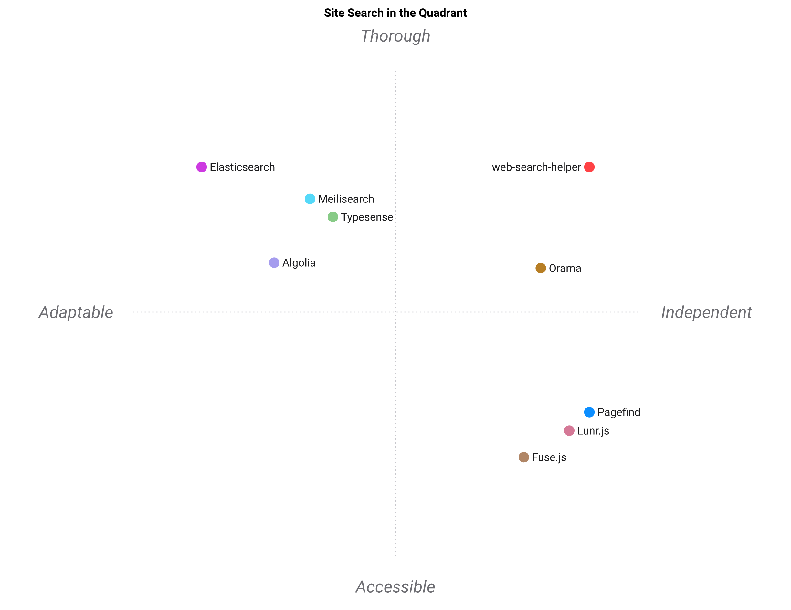

# Landscape

[🇫🇷](PAYSAGE.md)&nbsp;&nbsp;|&nbsp;&nbsp;[🇬🇧](LANDSCAPE.md)

How `web-search-helper` compares with the tools people reach for when a website
needs a search box. Each tool is rated on **this project's job: answering
questions about a private corpus from a site whose only server is PHP**. It is
not penalised for excelling at a different job (searching public documentation,
or a catalogue of a million products).

That job rules out most of the field before any feature is compared. A search
that runs entirely in the browser has to download what it searches, so the
corpus is public the moment the box works. A search server keeps the corpus
off the page but needs a process that a PHP-only host will not run. A hosted
service needs neither; it holds the corpus itself.

## At a glance

Rated ⭐ (absent or poor) to ⭐⭐⭐⭐⭐ (best in class) per column. The ratings are
a reading of each project's own documentation, not a benchmark;
[Sources and as-of date](#sources-and-as-of-date) says where they came from and
when.

- **Corpus stays private**: a visitor gets an answer, never the corpus. ⭐ when
  the index and the text are downloaded by the browser; ⭐⭐ when a third party
  holds the corpus and serves whole records to anyone with the public search
  key; ⭐⭐⭐ when it stays on your own server but a search returns whole
  documents unless you restrict the fields; ⭐⭐⭐⭐⭐ when only excerpts come
  back, under a quota.
- **PHP-only hosting**: works on a host that serves static files and PHP and
  nothing else.
- **No third-party service**: no outside company holds the corpus or sees the
  questions. Fetching a library or model weights from a public CDN costs one
  star.
- **Semantic matching**: finds the passage that answers a question even when
  it shares none of its words.
- **Honest refusal**: says "the corpus does not treat this" instead of
  returning the nearest thing it has. ⭐⭐ for a lexical engine, which returns
  nothing only when no word matches; ⭐⭐⭐ for a configurable score or
  similarity threshold; ⭐⭐⭐⭐⭐ for a calibrated absolute verdict.
- **Written answer**: an answer rather than a list of links. ⭐⭐ for
  highlighted excerpts; ⭐⭐⭐ for a generated answer that relies on an outside
  language model.
- **Typo tolerance**: a misspelt word still finds its passage.
- **Easy setup**: from nothing to a working search box.
- **Scale**: how large a corpus it stays comfortable with.

<!-- TABLE:START -->
| Site Search | Corpus stays private | PHP-only hosting | No third-party service | Semantic matching | Honest refusal | Written answer | Typo tolerance | Easy setup | Scale |
| --- | :---: | :---: | :---: | :---: | :---: | :---: | :---: | :---: | :---: |
| **web-search-helper** | ⭐⭐⭐⭐⭐ | ⭐⭐⭐⭐⭐ | ⭐⭐⭐⭐ | ⭐⭐⭐⭐ | ⭐⭐⭐⭐⭐ | ⭐⭐⭐⭐⭐ | ⭐⭐ | ⭐⭐⭐ | ⭐⭐ |
| Pagefind | ⭐ | ⭐⭐⭐⭐⭐ | ⭐⭐⭐⭐⭐ | ⭐ | ⭐⭐ | ⭐⭐ | ⭐⭐ | ⭐⭐⭐⭐⭐ | ⭐⭐⭐⭐ |
| Lunr.js | ⭐ | ⭐⭐⭐⭐⭐ | ⭐⭐⭐⭐⭐ | ⭐ | ⭐⭐ | ⭐ | ⭐⭐⭐ | ⭐⭐⭐⭐ | ⭐⭐ |
| Fuse.js | ⭐ | ⭐⭐⭐⭐⭐ | ⭐⭐⭐⭐⭐ | ⭐ | ⭐⭐ | ⭐ | ⭐⭐⭐⭐⭐ | ⭐⭐⭐⭐⭐ | ⭐ |
| Orama | ⭐⭐ | ⭐⭐⭐⭐ | ⭐⭐⭐⭐ | ⭐⭐⭐⭐ | ⭐⭐⭐ | ⭐⭐⭐ | ⭐⭐⭐⭐ | ⭐⭐⭐⭐ | ⭐⭐ |
| Algolia | ⭐⭐ | ⭐⭐⭐⭐ | ⭐ | ⭐⭐⭐⭐ | ⭐⭐ | ⭐⭐⭐ | ⭐⭐⭐⭐⭐ | ⭐⭐⭐⭐ | ⭐⭐⭐⭐⭐ |
| Meilisearch | ⭐⭐⭐ | ⭐⭐ | ⭐⭐⭐⭐⭐ | ⭐⭐⭐⭐ | ⭐⭐⭐ | ⭐⭐⭐ | ⭐⭐⭐⭐⭐ | ⭐⭐⭐ | ⭐⭐⭐⭐ |
| Typesense | ⭐⭐⭐ | ⭐⭐ | ⭐⭐⭐⭐⭐ | ⭐⭐⭐⭐ | ⭐⭐⭐ | ⭐⭐⭐ | ⭐⭐⭐⭐⭐ | ⭐⭐⭐⭐ | ⭐⭐⭐⭐ |
| Elasticsearch | ⭐⭐⭐ | ⭐ | ⭐⭐⭐⭐⭐ | ⭐⭐⭐⭐ | ⭐⭐⭐ | ⭐⭐ | ⭐⭐⭐⭐ | ⭐ | ⭐⭐⭐⭐⭐ |
<!-- TABLE:END -->

(Every tool but web-search-helper scores ⭐⭐⭐ or less on privacy, for one of
two reasons: either the browser downloads the index or a search returns whole
records. Neither is a flaw for public documentation, which is what most of
them were built for.)

## Positioning map

<!-- FIGURE:START -->
2D representation of the table above.

The map is a 2-D summary of the nine criteria, so read it as a shape, not a scoreboard. `web-search-helper` is at the top-right corner. The axes read **Horizontal: Adaptable ↔ Independent** and **Vertical: Accessible ↔ Thorough**.

The horizontal axis is mostly a question of where the search runs. Its right pole draws on *PHP-only hosting*, *honest refusal* and *written answer*; its left pole on *typo tolerance* and *scale*. Every tool that needs nothing more than a plain web host sits right of centre: web-search-helper and Pagefind (both at 1.44), Lunr.js (1.29), Orama (1.08), Fuse.js (0.95). The four that need a search server or a hosted service sit left of it: Typesense (−0.46), Meilisearch (−0.63), Algolia (−0.90), Elasticsearch (−1.44).

The vertical axis separates engines that read meaning from engines that match words. Its top pole draws on *corpus stays private*, *semantic matching*, *honest refusal* and *written answer*; its bottom pole on *easy setup* and, more faintly, *PHP-only hosting*. Fuse.js (−2.44), Lunr.js (−1.99) and Pagefind (−1.68) are the bottom of the map. Elasticsearch shares the top line with web-search-helper (2.44). Meilisearch (1.90) and Typesense (1.60) come next, then Algolia (0.83) and Orama (0.74), all of them still in the upper half.

Three groups follow. The static tools (Pagefind, Lunr.js, Fuse.js) hold the lower right: they run anywhere and understand no meaning. The servers and the hosted service (Elasticsearch, Meilisearch, Typesense, Algolia) hold the upper left: they match on meaning and can refuse past a threshold, on a machine you operate or a company you trust. The upper right holds web-search-helper and Orama, the latter at about a third of its height. The lower left is empty.
<!-- FIGURE:END -->

## Positioning

`web-search-helper` competes with these tools only on a narrow strip of
ground: a corpus that must stay private, on a host that runs PHP and nothing
else. Everyone else in the table was built for a public corpus or for a host
where you can run what you like; at that job, each of them beats this project.

The map shows the strip. The tools that run on a plain host are the static
ones, which ship the corpus to the browser; the tools that read meaning and
can refuse are servers or a service. web-search-helper borrows from both
sides: the search runs in one PHP file, asking no more of the host than a
static tool does; it reads meaning and refuses like a server would. The trick is to
split the work three ways. Your machine builds the index; the browser turns
the question into a vector; PHP only has to compare numbers and words, which it does well
enough for a book.

The table also shows what that costs, which the map hides. On its own row,
web-search-helper ties Pagefind for the weakest typo tolerance (⭐⭐) and ties
Lunr.js and Orama for the second-smallest scale (⭐⭐, above Fuse.js only).
Those are the two columns that weigh most on the Adaptable side of the
horizontal axis. Its setup (⭐⭐⭐) is heavier than any static tool's, because
a refusal is only honest once its thresholds have been measured on your
corpus.

Orama is the nearest neighbour in intent, with vector search, a similarity
threshold and answer sessions in one JavaScript engine. It is the one to watch:
run on a server, it would keep the corpus private, but that server is a
JavaScript runtime, which is what a PHP-only host does not offer.

## Per-tool write-up

### Pagefind
The best answer when the corpus is public. Pagefind runs after a static site
generator, writes a chunked index beside the pages and needs no server at all;
its stated aim is to perform well on large sites while spending as little of
the visitor's bandwidth as possible. Each result carries an excerpt cut from the
page. That excerpt comes from a fragment file the browser downloads, so a
patient visitor can collect the whole site, which costs nothing when the site
is public anyway. Matching is lexical, with stemming; its documentation
describes no typo tolerance and no matching on meaning.

### Lunr.js
The classic in-browser full-text index: build it once, serialise it to JSON,
load the whole of it in the page. It understands field boosts and edit-distance
queries (`foo~1`). Everything it searches is in the browser, so the corpus is
public; the size of that JSON caps the size of the corpus. MiniSearch and
FlexSearch sit in the same seat with different trade-offs between speed,
memory and features; for this job they rate the way Lunr does, so they are not
separate rows.

### Fuse.js
Fuzzy matching (the Bitap algorithm) over a list already in memory. There is no
index to build, which makes it the quickest to wire; typo tolerance is the
whole point of it. It compares the query against every record, so it suits a
few thousand short entries (names, titles, products) rather than a book. Its
site now also advertises Fuse Cloud, a hosted endpoint, which puts back the
third party that the library itself avoids.

### Orama
The neighbour whose ambitions overlap most: full-text, vector and hybrid search
plus chat sessions over the results, in a small JavaScript engine that runs in
the browser, on a server or at the edge. Its vector search takes a `similarity`
threshold (0.8 by default) under which nothing is returned, a real refusal
mechanism. In the browser it shares Lunr's privacy problem; on a server it needs
a JavaScript runtime, which a PHP host does not provide; its answer sessions
call a language model through Orama's Secure Proxy plugin.

### Algolia
Hosted search: you push records to Algolia, the page queries it with a
search-only key. Typo tolerance and scale are excellent. NeuralSearch adds
matching on meaning, but in Algolia's words "this feature isn't available on
every plan". DocSearch, its free programme for eligible documentation sites,
crawls public pages and offers keyword search or Ask AI. Whichever form you
use, the corpus lives at Algolia and any matching record comes back whole to
any page holding the public key: fine for documentation, unacceptable for a
manuscript you will not hand over.

### Meilisearch
A self-hosted search server, typo tolerant by default and quick to start, with
hybrid search through configurable embedders, one of which runs a Hugging Face
model locally. `rankingScoreThreshold` stops the search at the first document
whose score falls below a value; an experimental chat API writes answers
with a language model you configure. It is a process to keep running, so it
needs a server of its own or Meilisearch Cloud.

### Typesense
Meilisearch's closest twin: a single self-hosted binary, typo tolerant by
default, with semantic search out of the box through built-in models (an
S-BERT MiniLM in its own example) or external APIs. Vector and hybrid queries
accept a `distance_threshold`; a conversational search API builds answers
on top. The same verdict applies: excellent where you can run it, absent from
a PHP host unless Typesense Cloud runs it for you.

### Elasticsearch
Scale and every dial: BM25, `fuzziness`, dense vectors, semantic fields,
`min_score`. OpenSearch, its fork, rates the same way for this job. Operating a
JVM cluster to search one book is out of proportion; no PHP host offers it anyway.

## When to pick what

Most sites with a search box should not pick this project.

- **The corpus is public and the site is static.** Pagefind. It indexes the
  built site in one command, costs no server and stays light on bandwidth.
- **A short list: products, contacts, page titles.** Fuse.js. No index; the
  best typo tolerance in the table for a few lines of code.
- **You already run Node or an edge runtime and want hybrid search with chat in
  JavaScript.** Orama.
- **Open-source documentation.** DocSearch, if the project is eligible; for a
  commercial catalogue with a budget, Algolia itself.
- **You run your own servers and want instant, typo-tolerant search with
  meaning on top.** Meilisearch or Typesense, whichever API you prefer.
- **Millions of documents and a team that operates clusters.** Elasticsearch
  or OpenSearch.

Pick `web-search-helper` when all of these hold:

- The corpus must not be published: a manuscript, a course, an internal
  knowledge base.
- The host runs PHP and nothing else; you do not want a third party to
  hold the text either.
- An honest "I cannot answer" is worth more to you than the nearest passage.
- The corpus is a book or a shelf of them, thousands of passages rather than
  millions; `web-search-helper bench` measures the PHP time on your own index
  and says when that stops being true.

And know what it costs. Its typo tolerance is timid by design (`elefant` finds
`éléphant` only because `elefant` is absent from the corpus). Setting it up
means a Python step on your machine and a calibration on questions you write.
The first question downloads an embedding model of about 120 MB into the
visitor's browser.

## Sources and as-of date

The ratings were set and the sources below read on **2026-11-15**. These
projects ship often, so the date is part of the claim: check the column that
matters to you against the project's current documentation.

- Pagefind: [Getting started](https://pagefind.app/docs/), [JavaScript API](https://pagefind.app/docs/api/) (result excerpts), [ranking](https://pagefind.app/docs/ranking/), [repository](https://github.com/Pagefind/pagefind) ("static low-bandwidth search at scale").
- Lunr.js: [Searching](https://lunrjs.com/guides/searching.html) (fuzzy matches by edit distance).
- Fuse.js: [home page](https://www.fusejs.io/) (Bitap fuzzy search, Fuse Cloud).
- Orama: [repository](https://github.com/oramasearch/orama) (vector and hybrid search, `similarity` threshold, answer sessions through the Secure Proxy plugin).
- Algolia: [NeuralSearch](https://www.algolia.com/doc/guides/getting-started/neuralsearch/) (plan restriction), [What is DocSearch?](https://docsearch.algolia.com/docs/what-is-docsearch) (crawler, keyword search or Ask AI, eligibility).
- Meilisearch: [search API reference](https://www.meilisearch.com/docs/reference/api/search) (`rankingScoreThreshold`), [AI-powered search](https://www.meilisearch.com/docs/learn/ai_powered_search/getting_started_with_ai_search) (embedders, local Hugging Face), [chat](https://www.meilisearch.com/docs/learn/chat/getting_started_with_chat) (experimental chats API).
- Typesense: [semantic search guide](https://typesense.org/docs/guide/semantic-search.html) (built-in models), [vector search API](https://typesense.org/docs/30.2/api/vector-search.html) (`distance_threshold`), [conversational search](https://typesense.org/docs/30.2/api/conversational-search-rag.html).
- Elasticsearch: [match query](https://www.elastic.co/docs/reference/query-languages/query-dsl/query-dsl-match-query) (`fuzziness`, semantic fields).
- web-search-helper: [README](https://github.com/warith-harchaoui/web-search-helper/blob/main/README.md), read off this repository's code and tests at the version in `pyproject.toml`; it is the only row checked against code rather than documentation.
