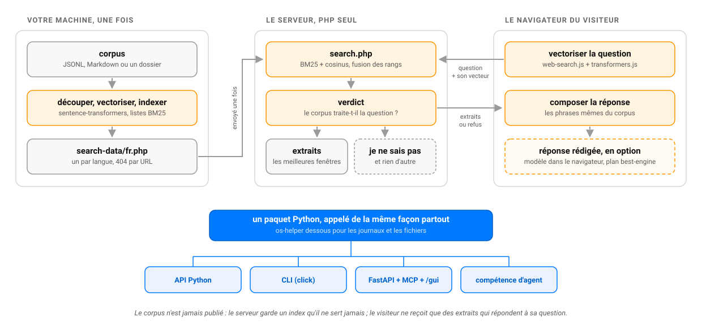

# web-search-helper

[🇫🇷](https://github.com/warith-harchaoui/web-search-helper/blob/main/LISEZMOI.md)&nbsp;&nbsp;|&nbsp;&nbsp;[🇬🇧](https://github.com/warith-harchaoui/web-search-helper/blob/main/README.md)


[](https://github.com/warith-harchaoui/web-search-helper/actions/workflows/ci.yml)

**Interroger un corpus privé depuis un site web, avec PHP pour seul serveur.**
Le corpus s'indexe sur votre machine ; un fichier PHP répond aux questions ; la
page calcule le vecteur de chaque question dans le navigateur. Le corpus n'est
jamais publié : le visiteur reçoit quelques phrases de ce qui répond ou un
« Je ne sais pas répondre » honnête, rien d'autre.

Laissez une [⭐️](https://github.com/warith-harchaoui/web-search-helper) sur GitHub si mon aide le mérite.

`web-search-helper` fait partie de la suite [**AI Helpers**](https://github.com/warith-harchaoui/ai-helpers).
Il fonctionne d'emblée en français comme en anglais (mots vides, composition
de la réponse, interface), avec un index par langue ; toute autre langue
demande seulement un fichier de mots vides. Par défaut, aucun LLM n'intervient :
la réponse est faite des phrases du corpus lui-même. En option, un petit modèle
de langue tourne dans le navigateur du visiteur et rédige la réponse à partir
des extraits, en les citant ; le modèle dépend de la machine et de la ligne du
visiteur, selon le plan préparé par
[`best-engine-ai-helper`](https://github.com/warith-harchaoui/best-engine-ai-helper).

## La promesse

web-search-helper est **privé par construction**. Trois cas, honnêtement :

1. **Garanti : le corpus n'est jamais publié.** L'index vit dans un fichier
   PHP qui répond un 404 vide quand on le demande par son URL, dans un
   dossier dont le `.htaccess` refuse tout. `search.php` renvoie des extraits
   de ce qui répond à la question, sinon rien. La question ne va qu'à votre
   propre serveur ; il garde une empreinte salée de l'adresse du visiteur
   avec les heures de ses appels du dernier jour, pour le quota, rien
   d'autre. Pas de télémétrie, pas de compte, pas de service de recherche
   tiers.
2. **Les réserves.** Les poids des modèles voyagent : sentence-transformers
   télécharge une fois le modèle de vectorisation sur votre machine ; le
   navigateur du visiteur télécharge son jumeau (environ 120 Mo) par
   transformers.js, puis le garde. La réponse rédigée, en option, fait venir
   un modèle plus lourd (3,1 à 5,6 Go) dans le navigateur du visiteur,
   seulement quand il appuie sur son bouton ; pour décider de le proposer, la
   page chronomètre d'abord une tranche de ses fichiers. Enfin, quelqu'un de patient, armé de milliers
   de questions bien choisies, peut encore recueillir une bonne partie du
   corpus, extrait après extrait : les protections décrites plus bas rendent
   cela lent, pas impossible.
3. **Votre décision.** `check-online` vérifie après chaque envoi qu'aucun
   octet du corpus n'est servi ; les seuils qui décident du refus, c'est à
   vous de les mesurer avec `calibrate`.

## Documentation

[💻 Documentation](https://deraison.ai/ai-helpers/docs/web-search-helper-doc/)

[🗺️ Paysage](https://github.com/warith-harchaoui/web-search-helper/blob/main/PAYSAGE.md)

[📋 Exemples](https://github.com/warith-harchaoui/web-search-helper/blob/main/EXEMPLES.md)

## Pourquoi

Une recherche entièrement dans le navigateur doit lui envoyer le corpus, puisqu'on
ne cherche que dans ce qu'on a. C'est acceptable pour une documentation publique,
pas pour un manuscrit, un cours ou une base interne. Chiffrer le fichier n'y
change rien : la clé doit être dans la page, elle aussi.

La plupart des hébergements offrent PHP et rien d'autre : ni Python, ni Node, ni
base vectorielle. web-search-helper tient dans ce cadre.

| Où | Ce qui tourne | Ce qu'il faut |
|---|---|---|
| votre machine | découper, vectoriser, indexer ; mesurer les seuils | Python ≥ 3.10, `sentence-transformers` |
| le serveur | `search.php` : BM25, cosinus, fusion, verdict ; rend des extraits | PHP ≥ 7.4 avec mbstring |
| le navigateur | `web-search.js` : vecteur de la question (transformers.js), réponse composée de phrases du corpus, réponse rédigée en option par un LLM dans le navigateur | un navigateur qui lit les modules ES ; WebGPU pour la réponse rédigée |

## Comment ça marche



## Comment il cherche

- **Les mots** : BM25, avec d'abord une passe conjonctive (quand certains
  passages contiennent tous les mots, eux seuls concourent) ; une tolérance
  timide aux fautes (« elefant » trouve « éléphant », mais seulement parce que
  « elefant » est absent du corpus).
- **Le sens** : chaque passage est découpé en fenêtres que le modèle lit en
  entier ; un passage vaut le cosinus de sa meilleure fenêtre. Chaque section
  a aussi un centroïde.
- **La fusion** : fusion de rang réciproque des deux classements.
- **Le verdict** : le moteur ne répond que si l'une de trois voies dit que le
  corpus traite la question : la meilleure fenêtre *et* la meilleure section
  sont proches par le sens ; tous les mots sont trouvés avec un BM25 fort ;
  pour un mot seul, il apparaît dans assez de passages. Sinon il ne rend rien.
  Un classement rend toujours *quelque chose* ; seule une mesure absolue sait
  dire non.

La recherche est exhaustive. `ann-router` choisirait HNSW dès 1 000 vecteurs
pour un budget de 10 ms ; mais ce budget est celui de numpy, les corpus visés
sont petits, puis le verdict juge le meilleur cosinus en valeur *absolue*,
qu'un index approché peut manquer. `web-search-helper bench` mesure le temps
PHP sur votre index et échoue au-delà du budget.

## Contre l'aspiration

1. Rien n'est rendu quand le corpus ne traite pas la question.
2. Un passage revient en extrait : sa meilleure fenêtre et la meilleure de ses
   voisines, recalées sur des fins de phrase. Jamais le passage entier.
3. Un plafond par adresse, par heure et par jour (empreinte salée de l'adresse,
   aucune autre trace).
4. Le fichier d'index est un script PHP : appelé par une URL, il répond un 404
   vide. Le dossier de données reçoit en plus un `.htaccess` qui refuse tout,
   par précaution.

Un visiteur patient, avec des milliers de questions bien choisies, peut encore
recueillir une bonne part du corpus. Ces mesures le ralentissent ; elles ne
l'empêchent pas.

## Questions inacceptables

Deux couches refusent une question avant toute recherche, et la page le dit
(`{"sure": false, "refused": "moderation" | "judge"}`) au lieu de « Je ne sais
pas répondre ».

1. **Le filtre**, toujours actif, porté par l'index : une courte liste de mots
   et d'expressions injurieux dans tout contexte (insultes racistes,
   antisémites ou homophobes, sites pornographiques, slogans nazis), en
   français et en anglais, reconnus comme mots entiers après pliage des
   accents, chiffres tapés pour des lettres rétablis, lettres étirées
   raccourcies. Un sujet n'est jamais sur la liste : « que dit le corpus du
   racisme des algorithmes » ou « des deepfakes pornographiques » passe. La
   liste vit dans `assets/moderation.json` ; `build(..., moderation={...})` la
   remplace, `moderation=False` la vide.

   Le même fichier porte des **règles**, un juge rudimentaire qui ne demande
   que PHP : une question est refusée quand une cible et une posture s'y
   rencontrent (un groupe de personnes et un prédicat dégradant, une demande et
   un contenu sexuel, « comment fabriquer » et une arme ou une drogue, la Shoah
   et « invention », Hitler et « avait raison », quelqu'un et « méritait d'être
   tué »), sauf si elle les cadre de façon critique (« biais », « stéréotype »,
   « racisme », « théorie »). Mesure : 40 sur 40 sur les questions étiquetées
   qui ont servi à les écrire, 50 sur 50 sur des questions neuves, et aucune
   des 55 000 phrases du livre pour lequel ce moteur a été conçu refusée. Un
   visiteur qui reformule avec des mots hors des listes passe : c'est le rôle
   du juge par modèle de langue. (Un juge fondé sur le vecteur de la question
   a été essayé d'abord puis écarté : les vecteurs MiniLM portent le sujet, pas
   la posture, et un vote des plus proches voisins se trompait une fois sur
   deux.)
2. **Le juge**, un modèle de langue qui tranche ce qu'aucune liste ne voit : un
   préjugé posé en question polie, une insulte déguisée en question sur le
   corpus. Sur le serveur, il intervient dès que `search-data/judge.php`
   existe :

   ```php
   <?php return ['url' => 'https://api.mistral.ai/v1/chat/completions',
                 'model' => 'mistral-small-latest', 'key' => '…',
                 'timeout' => 8, 'fail' => 'open'];
   ```

   Tout point d'accès de chat compatible OpenAI convient. Le fichier est du
   PHP : appelé par une URL, il ne montre rien, et le dossier de données
   refuse de toute façon chaque requête. Le verdict est gardé un jour sous une
   empreinte salée de la question, si bien que le second appel de la page ne
   redemande jamais ; le plafond passe avant le juge, si bien qu'un visiteur
   ne dépense pas vos crédits plus vite qu'il ne le permet. `'fail' =>
   'closed'` refuse la question quand le juge ne répond pas. La porte Python
   lit `WSH_JUDGE_URL`, `WSH_JUDGE_MODEL`, `WSH_JUDGE_KEY`,
   `WSH_JUDGE_TIMEOUT` et `WSH_JUDGE_FAIL`.

   Dans le navigateur, le modèle de rédaction juge lui-même la question avant
   d'écrire (`Writer.judge`) ; une question refusée n'obtient aucune réponse
   rédigée.

Le juge envoie la question du visiteur, et rien d'autre, au fournisseur que
vous configurez. Mesure avec le prompt livré sur 40 questions étiquetées (20 à
refuser, 20 à laisser passer, en français et en anglais) : Gemma 3 12B via
Ollama, aucune erreur, 2,6 s par question sur un portable Apple.

## Installation

Deux machines, deux besoins. Là où vous indexez (votre ordinateur) : Python 3.10
ou plus récent. Là où le site est servi : PHP 7.4 ou plus récent avec
`mbstring`, rien d'autre ; ni Python, ni base de données.

```bash
pip install web-search-helper                 # moteur, export PHP, CLI ; vectoriseur par hachage seulement
pip install 'web-search-helper[embed]'        # + sentence-transformers, le vrai vectoriseur
pip install 'web-search-helper[api,mcp,embed]'  # + l'API HTTP, /gui et le serveur MCP
pip install 'web-search-helper[route]'        # + l'avis d'ann-router à côté du temps PHP
```

Depuis un clone :

```bash
git clone https://github.com/warith-harchaoui/web-search-helper.git
cd web-search-helper
pip install -e '.[embed,api,mcp,dev]'
git config core.hooksPath .githooks     # la barrière pre-push : ruff, puis toute la suite de tests
```

Les tests qui comparent `engine.py` à `search.php` demandent `php` dans le PATH
(`brew install php` sur macOS, `sudo apt install php-cli php-mbstring` sur
Ubuntu).

## Prise en main rapide

```bash
pip install 'web-search-helper[embed]'

# 1. Indexer : un .jsonl (un passage par ligne), un fichier Markdown ou un dossier de ceux-ci.
web-search-helper build corpus/ -o build/fr.php --lang fr

# 2. Mesurer les seuils sur des questions auxquelles le corpus répond, puis sur d'autres auxquelles il ne répond pas.
web-search-helper calibrate build/fr.php --inside dedans.txt --outside dehors.txt --write

# 3. Essayer une question, telle que le serveur y répondra.
web-search-helper search build/fr.php "Quelle est la parabole de l'éléphant ?" --explain

# 4. Copier le point d'accès, le client et l'index dans le site ; le servir en local.
web-search-helper install site/ build/fr.php build/en.php --demo
web-search-helper serve site/        # http://127.0.0.1:8765/demo.html?lang=fr (ou ?lang=en)

# 5. Chronométrer le moteur PHP ; après l'envoi, vérifier que rien ne fuit.
web-search-helper bench build/fr.php
web-search-helper check-online https://exemple.org/recherche/ --lang fr
```

Enregistrements JSONL : `{"text": "...", "doc": "Titre du livre", "section": "Chapitre 2", "url": "page.html#x", "meta": {...}}`.
`meta` est transmis tel quel au navigateur.

## Dans la page

```html
<script type="module">
  import { WebSearch, composeAnswer } from './web-search.js';
  const ws = new WebSearch({ endpoint: 'search.php', lang: 'fr' });
  const r = await ws.ask(question, { onLexical: (first) => { /* réponse précoce */ } });
  if (!r.sure) showUnknown();
  else show(await composeAnswer(r, { lang: 'fr', embed: ws }), r.hits);
</script>
```

`ask` fait deux appels : les mots seuls d'abord (immédiat, avant que le modèle
soit chargé), puis les mots avec le sens. La réponse que compose
`composeAnswer` est faite de phrases du corpus, mot pour mot, choisies par
pertinence marginale maximale ; rien n'est généré. Les types sont dans
`web-search.d.ts`. `mount(form, output, options)` branche un widget minimal.

## Une réponse rédigée, dans le navigateur du visiteur

`mount(form, output, { …, writer: true })` ajoute un bouton sous un résultat
`sure` : un petit modèle de langue, que transformers.js fait tourner sur WebGPU
dans le navigateur du visiteur, reformule les extraits en une réponse qui les
cite en [1], [2]… Rien ne quitte le navigateur ; le serveur ne change pas.

Le choix du modèle ne se fait pas dans ce paquet. `writer-plan.json`, écrit par
`best-engine-ai-helper browser plan --usage rag-answer`, est une échelle
ordonnée par des scores mesurés sur cette tâche même : Gemma 4 E4B (0,722) puis
Gemma 4 E2B (0,667), chacun en q4f16 et q4, avec fichiers et tailles exacts (de
3,1 à 5,6 Go). LFM2 1.2B a été mesuré aussi (0,167 : la plupart de ses réponses
ne citent rien) puis écarté ; une machine qui ne peut pas télécharger un Gemma
garde donc la réponse extractive plutôt qu'une réponse qu'elle écarterait.
`scripts/eval_writer.py` refait la mesure sur votre propre corpus ;
`scripts/make_writer_plan.py` réécrit le plan depuis best-engine. La page sonde
la machine (WebGPU, shader-f16, mémoire de l'appareil, stockage, mobile,
économiseur de données), regarde le cache du navigateur, mesure le débit par
une requête Range sur les fichiers du modèle lui-même, puis prend le premier
barreau qu'elle peut télécharger dans `max_download_s` (180 s). Rien ne
convient : pas de bouton, la réponse extractive reste. `chooseRung` est testé
contre `browser.choose`, la version Python de best-engine, sur 2 251 appareils
simulés.

La réponse rédigée est vérifiée avant d'être montrée : le modèle ne voit qu'un
résultat `sure` ; il a pour consigne de n'utiliser que les extraits puis de
dire quand ils ne suffisent pas ; chaque phrase qu'il écrit doit retrouver la
plupart de ses mots pleins dans les extraits qu'elle cite (`checkGrounding`).
Sinon la page écarte la réponse rédigée et garde l'extractive. Les extraits
restent listés dessous, mot pour mot.

```js
import { Writer } from './web-search.js';
const { writer, reason } = await Writer.create('writer-plan.json');  // null quand rien ne convient
const answer = writer && await writer.write(result, { question, lang: 'fr', onText: show });
if (answer && answer.grounded) show(answer.text);
```

## Les autres portes de la suite

Comme tout AI Helper, le moteur répond aussi en HTTP et en MCP, pour les
agents, les scripts et les essais en local sans PHP (`search.php` reste le
serveur de production) :

```bash
pip install 'web-search-helper[api,mcp,embed]'
WSH_DATA_DIR=site/search-data web-search-helper-api    # http://127.0.0.1:8040/docs, /gui
WSH_DATA_DIR=site/search-data web-search-helper-mcp    # MCP sur http://127.0.0.1:8041/mcp
```

Routes : `POST /query` parle le protocole de `search.php`, si bien que
`web-search.js` peut s'y brancher (c'est ce que fait `/gui`) ; `POST /search`
prend une question en clair et la vectorise côté serveur ; `GET /indexes` ;
`POST /calibrate` (n'écrit rien) ; `POST /check-online`. Les outils MCP sont
`indexes`, `search`, `calibrate` et `check_online`. La compétence pour agent
(*skill*, un mode d'emploi qu'un agent charge à la demande) se trouve dans
`skills/web-search-helper/` ; `TRIGGERS.md` liste ce qui devrait faire appel
à cette brique puis ce qui ne le devrait pas ; un test le garde identique à la
copie de la compétence.

L'API existe aussi en conteneur (`Dockerfile`, `docker-compose.yml`) : elle
lit les index dans `./search-data`, monté en lecture seule, puis sert le port
8040 avec une sonde `/health`. [`GUI.md`](https://github.com/warith-harchaoui/web-search-helper/blob/main/GUI.md) décrit la page `/gui` (en anglais).

```bash
docker compose up --build      # http://localhost:8040/gui?lang=fr
```

## Apporter ses propres vecteurs

Un site qui vectorise déjà son corpus peut garder ses vecteurs et ne confier
que la recherche au moteur : `from_vectors(rows, vectors, lang, model)`
construit l'index à partir des passages (`t`, `c`, `s`, les fins de fenêtres
`o`, `u` et `m` en option) avec un vecteur normalisé par fenêtre ;
`vectors_from_int8` relit des vecteurs int8 comme le ferait un navigateur.
C'est ainsi qu'« Interroger le livre » est passé d'une recherche tout entière
dans le navigateur à `search.php` avec les MÊMES vecteurs, mots vides et
seuils : seul l'endroit du calcul a changé.

## Python

```python
import web_search_helper as wsh

idx = wsh.build(wsh.read_corpus("corpus/"), wsh.SentenceTransformerEmbedder(), "fr")
wsh.save(idx, "build/fr.php")
print(wsh.search(idx, "le mur des données", explain=True))
```

`engine.py` est le jumeau de référence de `search.php` ;
`tests/test_php_parity.py` fait tourner les deux sur les mêmes questions et
échoue s'ils divergent.

## Limites

- Le vecteur de la question est calculé par transformers.js dans la page ;
  celui de l'index par sentence-transformers ici : mêmes poids, cosinus égaux
  à 1e-2 près environ. Le calibrage indique ses marges ; un seuil dont la marge
  est plus faible que cela est fragile.
- Un index par langue ; la page dit dans quelle langue elle interroge.
- La première question télécharge le modèle dans le navigateur (environ
  120 Mo pour le MiniLM multilingue par défaut), que le navigateur garde
  ensuite.

## Auteur

[Warith HARCHAOUI](https://deraison.ai), Ph.D.

## Licence

BSD-3-Clause ; voir [LICENSE](https://github.com/warith-harchaoui/web-search-helper/blob/main/LICENSE).
