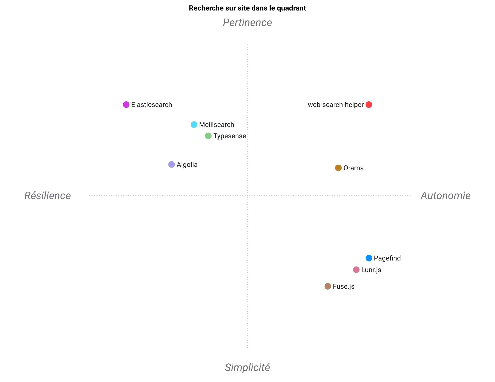

# Paysage

[🇫🇷](PAYSAGE.md)&nbsp;&nbsp;|&nbsp;&nbsp;[🇬🇧](LANDSCAPE.md)

Comment `web-search-helper` se compare aux outils qu'on prend quand un site a
besoin d'une boîte de recherche. Chaque outil est noté sur **le travail de ce
projet : répondre aux questions sur un corpus privé depuis un site dont le seul
serveur est PHP**, sans être pénalisé pour exceller à un autre travail
(chercher dans une documentation publique, dans un catalogue d'un million de
produits).

Ce travail écarte l'essentiel du domaine avant toute comparaison de
fonctions. Une recherche qui tourne entièrement dans le navigateur doit
télécharger ce qu'elle cherche : le corpus devient public dès que la boîte
fonctionne. Un serveur de recherche garde le corpus hors de la page, mais il
lui faut un processus qu'un hébergement PHP seul ne fera pas tourner. Un
service hébergé n'a besoin ni de l'un ni de l'autre ; c'est lui qui détient le
corpus.

## En un coup d'œil

Notes de ⭐ (absent ou faible) à ⭐⭐⭐⭐⭐ (meilleur de sa catégorie) par colonne.
Elles sont une lecture de la documentation de chaque projet, pas un banc
d'essai ; [Sources et date de relevé](#sources-et-date-de-relevé) dit d'où
elles viennent et de quand.

- **Corpus gardé privé** : le visiteur reçoit une réponse, jamais le corpus.
  ⭐ quand le navigateur télécharge l'index avec le texte ; ⭐⭐ quand un tiers
  détient le corpus et sert les fiches entières à quiconque possède la clé de
  recherche publique ; ⭐⭐⭐ quand il reste sur votre serveur mais qu'une
  recherche renvoie les documents entiers, sauf à restreindre les champs ;
  ⭐⭐⭐⭐⭐ quand seuls des extraits reviennent, sous quota.
- **Hébergement PHP seul** : fonctionne chez un hébergeur qui sert des
  fichiers statiques et du PHP, rien d'autre.
- **Aucun service tiers** : aucune entreprise extérieure ne détient le corpus
  ni ne voit les questions. Aller chercher une bibliothèque ou des poids de
  modèle sur un *CDN* public (réseau de diffusion de contenu, ces serveurs
  publics qui distribuent des fichiers courants) coûte une étoile.
- **Correspondance sémantique** : trouve le passage qui répond à une question
  même s'il n'en partage aucun mot.
- **Refus honnête** : dit « le corpus ne traite pas de cela » au lieu de
  renvoyer ce qu'il a de plus proche. ⭐⭐ pour un moteur lexical, qui ne
  renvoie rien seulement quand aucun mot ne correspond ; ⭐⭐⭐ pour un seuil
  de score ou de similarité réglable ; ⭐⭐⭐⭐⭐ pour un verdict absolu, étalonné.
- **Réponse rédigée** : une réponse plutôt qu'une liste de liens. ⭐⭐ pour
  des extraits surlignés ; ⭐⭐⭐ pour une réponse générée qui s'appuie sur un
  modèle de langage extérieur.
- **Tolérance aux fautes** : un mot mal orthographié trouve encore son
  passage.
- **Mise en place facile** : de rien à une boîte de recherche qui marche.
- **Passage à l'échelle** : la taille de corpus avec laquelle il reste à
  l'aise.

<!-- TABLE:START -->
| Recherche sur site | Corpus gardé privé | Hébergement PHP seul | Aucun service tiers | Correspondance sémantique | Refus honnête | Réponse rédigée | Tolérance aux fautes | Mise en place facile | Passage à l'échelle |
| --- | :---: | :---: | :---: | :---: | :---: | :---: | :---: | :---: | :---: |
| **web-search-helper** | ⭐⭐⭐⭐⭐ | ⭐⭐⭐⭐⭐ | ⭐⭐⭐⭐ | ⭐⭐⭐⭐ | ⭐⭐⭐⭐⭐ | ⭐⭐⭐⭐⭐ | ⭐⭐ | ⭐⭐⭐ | ⭐⭐ |
| Pagefind | ⭐ | ⭐⭐⭐⭐⭐ | ⭐⭐⭐⭐⭐ | ⭐ | ⭐⭐ | ⭐⭐ | ⭐⭐ | ⭐⭐⭐⭐⭐ | ⭐⭐⭐⭐ |
| Lunr.js | ⭐ | ⭐⭐⭐⭐⭐ | ⭐⭐⭐⭐⭐ | ⭐ | ⭐⭐ | ⭐ | ⭐⭐⭐ | ⭐⭐⭐⭐ | ⭐⭐ |
| Fuse.js | ⭐ | ⭐⭐⭐⭐⭐ | ⭐⭐⭐⭐⭐ | ⭐ | ⭐⭐ | ⭐ | ⭐⭐⭐⭐⭐ | ⭐⭐⭐⭐⭐ | ⭐ |
| Orama | ⭐⭐ | ⭐⭐⭐⭐ | ⭐⭐⭐⭐ | ⭐⭐⭐⭐ | ⭐⭐⭐ | ⭐⭐⭐ | ⭐⭐⭐⭐ | ⭐⭐⭐⭐ | ⭐⭐ |
| Algolia | ⭐⭐ | ⭐⭐⭐⭐ | ⭐ | ⭐⭐⭐⭐ | ⭐⭐ | ⭐⭐⭐ | ⭐⭐⭐⭐⭐ | ⭐⭐⭐⭐ | ⭐⭐⭐⭐⭐ |
| Meilisearch | ⭐⭐⭐ | ⭐⭐ | ⭐⭐⭐⭐⭐ | ⭐⭐⭐⭐ | ⭐⭐⭐ | ⭐⭐⭐ | ⭐⭐⭐⭐⭐ | ⭐⭐⭐ | ⭐⭐⭐⭐ |
| Typesense | ⭐⭐⭐ | ⭐⭐ | ⭐⭐⭐⭐⭐ | ⭐⭐⭐⭐ | ⭐⭐⭐ | ⭐⭐⭐ | ⭐⭐⭐⭐⭐ | ⭐⭐⭐⭐ | ⭐⭐⭐⭐ |
| Elasticsearch | ⭐⭐⭐ | ⭐ | ⭐⭐⭐⭐⭐ | ⭐⭐⭐⭐ | ⭐⭐⭐ | ⭐⭐ | ⭐⭐⭐⭐ | ⭐ | ⭐⭐⭐⭐⭐ |
<!-- TABLE:END -->

(Tous les outils sauf web-search-helper obtiennent ⭐⭐⭐ ou moins sur la
confidentialité, pour l'une de deux raisons : le navigateur télécharge l'index,
sinon une recherche renvoie des fiches entières. Ni l'une ni l'autre n'est un
défaut pour une documentation publique, ce pour quoi la plupart ont été
conçus.)

## Carte de positionnement

<!-- FIGURE:START -->
Représentation 2D du tableau ci-dessus.

La carte est un résumé en 2D des 9 critères : à lire comme une forme, pas comme un classement. « web-search-helper » se situe dans le coin en haut à droite. Les axes se lisent **Horizontal : Résilience ↔ Autonomie** et **Vertical : Simplicité ↔ Pertinence**.

L'axe horizontal dit surtout où tourne la recherche. Son pôle droit s'appuie sur *hébergement PHP seul*, *refus honnête* et *réponse rédigée* ; son pôle gauche sur *tolérance aux fautes* et *passage à l'échelle*. Tous les outils qui se contentent d'un simple hébergement web sont à droite du centre : web-search-helper et Pagefind (tous deux à 1,44), Lunr.js (1,29), Orama (1,08), Fuse.js (0,95). Les quatre qui demandent un serveur de recherche ou un service hébergé sont à gauche : Typesense (−0,46), Meilisearch (−0,63), Algolia (−0,90), Elasticsearch (−1,44).

L'axe vertical sépare les moteurs qui lisent le sens de ceux qui comparent des mots. Son pôle haut s'appuie sur *corpus gardé privé*, *correspondance sémantique*, *refus honnête* et *réponse rédigée* ; son pôle bas sur *mise en place facile* puis, plus faiblement, *hébergement PHP seul*. Fuse.js (−2,44), Lunr.js (−1,99) et Pagefind (−1,68) forment le bas de la carte. Elasticsearch partage la ligne du haut avec web-search-helper (2,44). Viennent ensuite Meilisearch (1,90) puis Typesense (1,60), enfin Algolia (0,83) avec Orama (0,74), tous encore dans la moitié supérieure.

Trois groupes en découlent. Les outils statiques (Pagefind, Lunr.js, Fuse.js) tiennent le quart inférieur droit : ils tournent partout et ne comprennent aucun sens. Les serveurs avec le service hébergé (Elasticsearch, Meilisearch, Typesense, Algolia) tiennent le quart supérieur gauche : ils cherchent sur le sens et savent refuser sous un seuil, sur une machine que vous exploitez ou chez une entreprise à qui vous faites confiance. Le quart supérieur droit accueille web-search-helper avec Orama, ce dernier à environ un tiers de sa hauteur. Le quart inférieur gauche est vide.
<!-- FIGURE:END -->

## Positionnement

`web-search-helper` ne concurrence ces outils que sur une bande de terrain
étroite : un corpus qui doit rester privé, chez un hébergeur qui fait tourner
PHP et rien d'autre. Tous les autres outils du tableau ont été conçus pour un
corpus public, sinon pour un hébergement où l'on fait tourner ce qu'on veut ;
sur ce travail-là, ils font mieux que ce projet.

La carte montre cette bande. Les outils qui tournent sur un simple hébergement
sont les outils statiques, qui envoient le corpus au navigateur ; ceux qui
lisent le sens et savent refuser sont des serveurs ou un service.
web-search-helper emprunte aux deux côtés : la recherche tient dans un seul
fichier PHP, ce qu'un outil statique demanderait à l'hébergeur ; elle lit le
sens puis refuse comme le ferait un serveur. Le procédé consiste à répartir le
travail en trois. Votre machine construit l'index ; le navigateur transforme la
question en vecteur ; PHP n'a plus qu'à comparer des nombres et des mots, ce
qu'il fait assez bien pour un livre.

Le tableau montre aussi ce que cela coûte ; la carte, elle, le cache. Sur sa propre
ligne, web-search-helper partage avec Pagefind la plus faible tolérance aux
fautes (⭐⭐) ; il partage avec Lunr.js et Orama le deuxième plus petit passage
à l'échelle (⭐⭐, au-dessus de Fuse.js seulement). Ce sont les deux colonnes
qui pèsent le plus du côté Résilience de l'axe horizontal. Sa mise en place (⭐⭐⭐) est plus
lourde que celle de n'importe quel outil statique, car un refus n'est honnête
qu'une fois ses seuils mesurés sur votre corpus.

Orama est le voisin le plus proche par l'intention : recherche vectorielle,
seuil de similarité, sessions de réponse dans un seul moteur JavaScript. C'est
lui qu'il faut surveiller. Lancé sur un serveur, il garderait le corpus privé ;
mais ce serveur est un environnement JavaScript, ce qu'un hébergement PHP seul
ne fournit pas.

## Fiche par outil

### Pagefind
La meilleure réponse quand le corpus est public. Pagefind passe après un
générateur de site statique, écrit un index découpé en morceaux à côté des
pages ; il ne demande aucun serveur. Son but affiché : rester performant sur de
grands sites tout en consommant le moins possible de la bande passante du
visiteur. Chaque résultat porte un extrait tiré de la page. Cet extrait vient
d'un fichier fragment que le navigateur télécharge : un visiteur patient peut
donc récupérer tout le site, ce qui ne coûte rien quand le site est public de
toute façon. La correspondance est lexicale, avec racinisation ; sa
documentation ne décrit ni tolérance aux fautes ni correspondance sur le sens.

### Lunr.js
L'index plein texte classique dans le navigateur : on le construit une fois, on
le sérialise en JSON, puis la page le charge en entier. Il connaît la
pondération des champs et les requêtes par distance d'édition (`foo~1`). Tout
ce qu'il cherche est dans le navigateur, donc le corpus est public ; la taille
de ce JSON plafonne celle du corpus. MiniSearch et FlexSearch occupent la même
place avec d'autres arbitrages entre vitesse, mémoire et fonctions ; pour ce
travail ils se notent comme Lunr, d'où l'absence de lignes à part.

### Fuse.js
La correspondance approchée (l'algorithme Bitap) sur une liste déjà en mémoire.
Pas d'index à construire, ce qui en fait le plus rapide à brancher ; la
tolérance aux fautes est toute sa raison d'être. Il compare la requête à chaque
fiche : il convient à quelques milliers d'entrées courtes (noms, titres,
produits), pas à un livre. Son site met désormais en avant Fuse Cloud, une
version hébergée, qui réintroduit le tiers que la bibliothèque évite.

### Orama
Le voisin dont les ambitions recoupent le plus les nôtres : recherche plein
texte, vectorielle et hybride, sessions de conversation sur les résultats, dans
un petit moteur JavaScript qui tourne dans le navigateur, sur un serveur ou en
périphérie de réseau. Sa recherche vectorielle prend un seuil `similarity`
(0,8 par défaut) sous lequel rien ne revient : un vrai mécanisme de refus.
Dans le navigateur, il partage le problème de confidentialité de Lunr ; sur un
serveur, il lui faut un environnement JavaScript, qu'un hébergement PHP ne
fournit pas ; ses sessions de réponse appellent un modèle de langage via le
greffon Secure Proxy d'Orama.

### Algolia
La recherche hébergée : on pousse les fiches chez Algolia, la page l'interroge
avec une clé de recherche seule. Tolérance aux fautes et passage à l'échelle
excellents. NeuralSearch ajoute la correspondance sur le sens, mais selon
Algolia elle-même la fonction n'est pas disponible dans toutes les offres.
DocSearch, son programme gratuit pour les documentations éligibles, explore des
pages publiques puis propose une recherche par mots-clés ou Ask AI. Sous toutes
ses formes, le corpus vit chez Algolia ; toute fiche qui correspond revient
entière à n'importe quelle page qui détient la clé publique. Parfait pour une
documentation, inadapté à un manuscrit qu'on ne veut pas confier.

### Meilisearch
Un serveur de recherche auto-hébergé, tolérant aux fautes par défaut, rapide à
démarrer, avec une recherche hybride par modèles de plongement configurables (un modèle de plongement transforme un texte en vecteur), dont l'un
fait tourner un modèle Hugging Face en local. `rankingScoreThreshold` arrête la
recherche au premier document dont le score passe sous une valeur ; une API de
conversation, expérimentale, rédige des réponses avec le modèle de langage que
vous configurez. C'est un processus à maintenir en vie : il lui faut un serveur
à lui, sinon Meilisearch Cloud.

### Typesense
Le jumeau le plus proche de Meilisearch : un seul binaire auto-hébergé,
tolérant aux fautes par défaut, avec une recherche sémantique prête à l'emploi
grâce à des modèles intégrés (un MiniLM S-BERT dans son propre exemple) ou à
des API extérieures. Les requêtes vectorielles et hybrides acceptent un
`distance_threshold` ; une API de recherche conversationnelle construit des
réponses par-dessus. Même verdict : excellent là où l'on peut le faire tourner,
absent d'un hébergement PHP à moins que Typesense Cloud le fasse tourner pour
vous.

### Elasticsearch
L'échelle avec tous les réglages : BM25, `fuzziness`, vecteurs denses, champs
sémantiques, `min_score`. OpenSearch, sa bifurcation, se note de la même façon
pour ce travail. Exploiter une grappe JVM pour chercher dans un seul livre est
disproportionné ; aucun hébergement PHP ne le propose.

## Quand choisir quoi

La plupart des sites dotés d'une boîte de recherche ne devraient pas choisir ce
projet.

- **Le corpus est public, le site statique.** Pagefind. Il indexe le site
  construit en une commande, ne coûte aucun serveur et ménage la bande
  passante.
- **Une liste courte : produits, contacts, titres de pages.** Fuse.js. Pas
  d'index, la meilleure tolérance aux fautes du tableau en quelques lignes.
- **Vous faites déjà tourner Node ou un environnement en périphérie et voulez
  la recherche hybride avec conversation en JavaScript.** Orama.
- **Une documentation libre.** DocSearch si le projet est éligible ; pour un
  catalogue commercial doté d'un budget, Algolia lui-même.
- **Vous exploitez vos propres serveurs et voulez une recherche instantanée,
  tolérante aux fautes, avec le sens en plus.** Meilisearch ou Typesense,
  selon l'API que vous préférez.
- **Des millions de documents et une équipe qui exploite des grappes.**
  Elasticsearch, sinon OpenSearch.

Choisissez `web-search-helper` quand tout cela est vrai :

- Le corpus ne doit pas être publié : un manuscrit, un cours, une base de
  connaissances interne.
- L'hébergeur fait tourner PHP, rien d'autre ; vous ne voulez pas non plus
  qu'un tiers détienne le texte.
- Un « je ne peux pas répondre » honnête vaut plus pour vous que le passage le
  plus proche.
- Le corpus est un livre ou une étagère de livres, des milliers de passages et
  non des millions ; `web-search-helper bench` mesure le temps PHP sur votre
  propre index et dit quand ce n'est plus vrai.

Sachez aussi ce qu'il coûte. Sa tolérance aux fautes est timide par
construction (`elefant` trouve `éléphant` seulement parce que `elefant` est
absent du corpus). La mise en place demande une étape Python sur votre machine
puis un étalonnage sur des questions que vous écrivez. La première question
télécharge dans le navigateur du visiteur un modèle de plongement d'environ
120 Mo.

## Sources et date de relevé

Les notes ont été fixées et les sources ci-dessous lues le **2026-11-15**. Ces
projets publient souvent : la date fait partie de l'affirmation. Vérifiez la
colonne qui compte pour vous dans la documentation actuelle du projet.

- Pagefind : [prise en main](https://pagefind.app/docs/), [API JavaScript](https://pagefind.app/docs/api/) (extraits des résultats), [classement](https://pagefind.app/docs/ranking/), [dépôt](https://github.com/Pagefind/pagefind) (« static low-bandwidth search at scale »).
- Lunr.js : [Searching](https://lunrjs.com/guides/searching.html) (correspondances approchées par distance d'édition).
- Fuse.js : [page d'accueil](https://www.fusejs.io/) (recherche approchée Bitap, Fuse Cloud).
- Orama : [dépôt](https://github.com/oramasearch/orama) (recherche vectorielle et hybride, seuil `similarity`, sessions de réponse via le greffon Secure Proxy).
- Algolia : [NeuralSearch](https://www.algolia.com/doc/guides/getting-started/neuralsearch/) (restriction selon l'offre), [What is DocSearch?](https://docsearch.algolia.com/docs/what-is-docsearch) (robot d'exploration, mots-clés ou Ask AI, éligibilité).
- Meilisearch : [référence de l'API de recherche](https://www.meilisearch.com/docs/reference/api/search) (`rankingScoreThreshold`), [recherche par IA](https://www.meilisearch.com/docs/learn/ai_powered_search/getting_started_with_ai_search) (modèles de plongement, Hugging Face en local), [conversation](https://www.meilisearch.com/docs/learn/chat/getting_started_with_chat) (API expérimentale).
- Typesense : [guide de recherche sémantique](https://typesense.org/docs/guide/semantic-search.html) (modèles intégrés), [API de recherche vectorielle](https://typesense.org/docs/30.2/api/vector-search.html) (`distance_threshold`), [recherche conversationnelle](https://typesense.org/docs/30.2/api/conversational-search-rag.html).
- Elasticsearch : [match query](https://www.elastic.co/docs/reference/query-languages/query-dsl/query-dsl-match-query) (`fuzziness`, champs sémantiques).
- web-search-helper : [LISEZMOI](https://github.com/warith-harchaoui/web-search-helper/blob/main/LISEZMOI.md), lu sur le code et les tests de ce dépôt à la version de `pyproject.toml` ; c'est la seule ligne vérifiée sur du code plutôt que sur une documentation.
